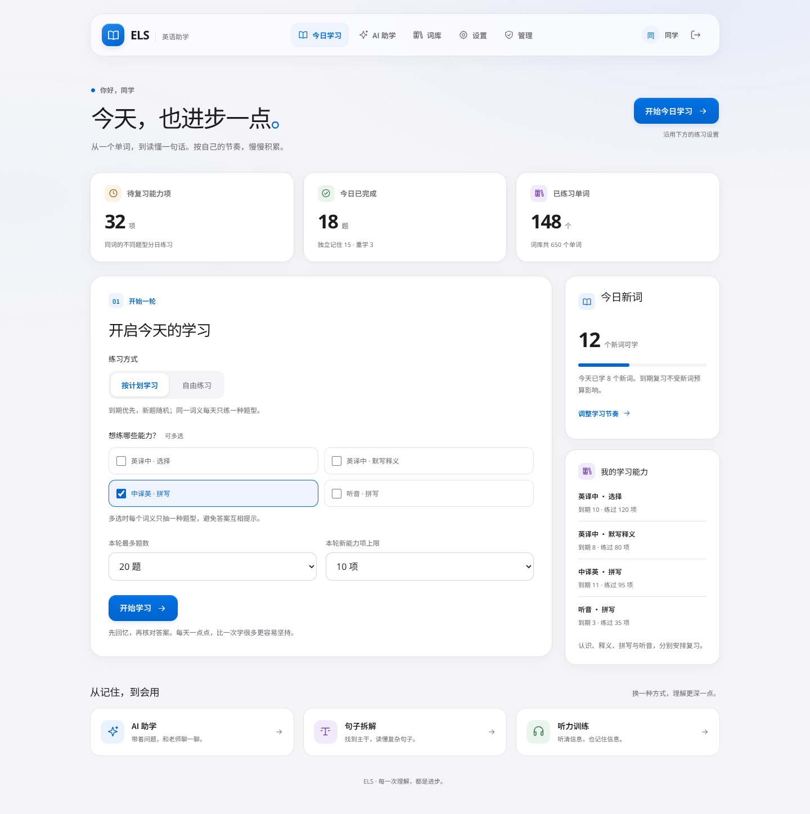
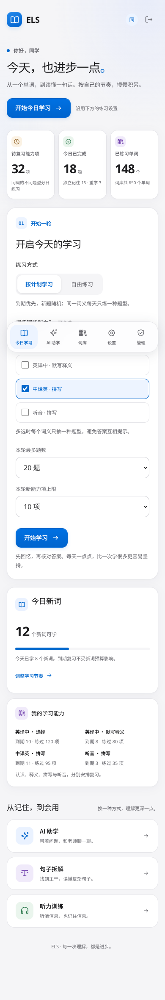
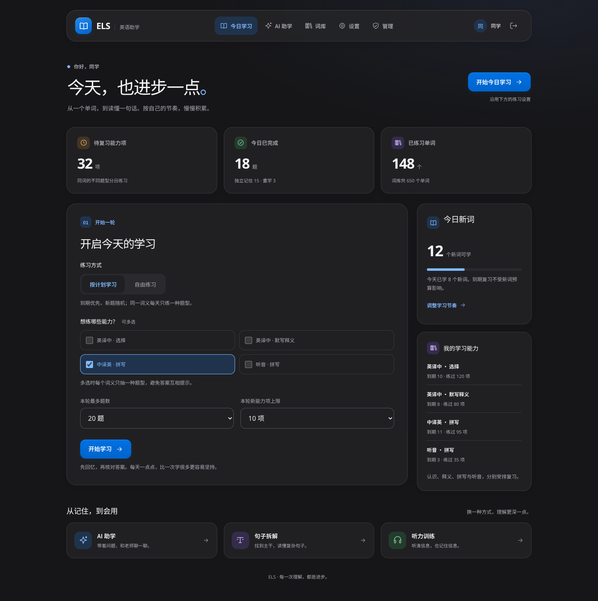
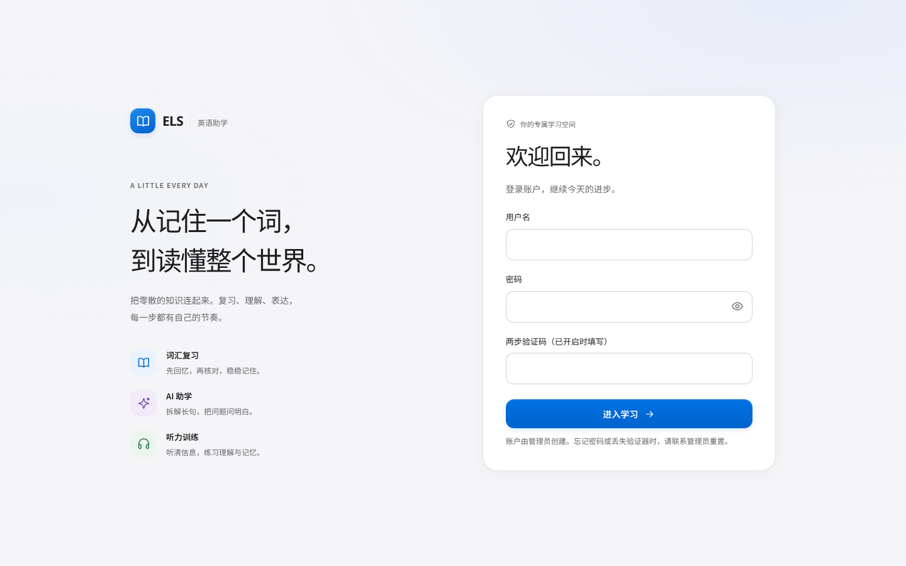

# ELS 前端设计

界面参考 Apple 的排版、圆角、空间层级和导航材质。学习内容使用实色卡片，玻璃仅用于顶部导航或手机底部导航，避免多层模糊影响文字阅读和低性能设备。

## 页面与操作

- 首页：显示真实账户的复习数、完成数和词汇数；快捷开始按钮沿用下方练习设置。桌面并排显示练习、新词预算和能力记录；手机按阅读顺序排列。
- AI 助学：辅导对话、句子拆解、听力训练使用统一分段控件。首页入口分别对应 `/assistant#chat`、`/assistant#sentence`、`/assistant#listening`；明确选择的入口优先于恢复的历史训练类型。
- 词库：搜索、音标、释义、参与学习/暂停状态和分页有明确层级；空词库与无搜索结果分别解释下一步。
- 设置与管理：沿用账户和管理员验证流程，用统一表单、间距和表格容器展示配置。
- 登录：桌面介绍与登录表单并排；手机直接呈现登录表单。显示/隐藏密码按钮不改变密码内容或自动填充语义。

## 适配与可访问性

宽度 700px 及以下使用底部导航，同一组链接保留文字与图标。为安全区、底部滚动和键盘焦点预留空间；管理员五项、普通用户四项导航均有至少 44px 的可点区域。

颜色随系统明暗模式切换。支持减少动效、减少透明度、提高对比度和强制颜色；不限制页面缩放。输入框至少使用 16px 字体，避免手机输入时自动放大。

图标为项目内 SVG，无图标库、远程字体、图片或额外客户端依赖。正文区域不使用 backdrop-filter。系统不支持该效果时，导航回退为实色。保留原生表单行为、`aria-current`、`aria-pressed`、提交状态和错误提示，并提供键盘跳到内容的入口。

参考：[Apple Materials](https://developer.apple.com/design/human-interface-guidelines/materials)、[Meet Liquid Glass](https://developer.apple.com/videos/play/wwdc2025/219/)、[Apple Accessibility](https://developer.apple.com/design/human-interface-guidelines/accessibility)。这是 Web 实现，未声称复现原生 Liquid Glass 的光学渲染。

## 预览

以下是本地浏览器使用模拟账户和学习数据生成的截图，不代表已导入教材或生产数据。页面运行时只显示当前账户的真实 API 数据。

## 验证

`apps/web` 的 6 个状态测试、TypeScript 检查和 Next.js 生产构建通过。生产构建下运行 Chromium 模拟 API 回归，共 75 项检查通过：55 项布局检查、10 项 axe-core 可访问性扫描与 10 项交互/辅助模式检查，未发现对应 WCAG A/AA 规则违规。完整账户、数据库和模型授权的 CI 继续使用原有三个检查任务。

浏览器回归覆盖 320、390、600、700、768、1024、1440px 页面宽度，作答/评级/撤销/暂停、首页助学入口、历史恢复、词条暂停/搜索、设置保存、登录/退出及权限导航。额外检查明暗模式、减少动效与透明度、提高对比度和键盘跳转。模拟 API 不调用付费模型；手机和平板的系统键盘与设备性能仍以实机为准。
