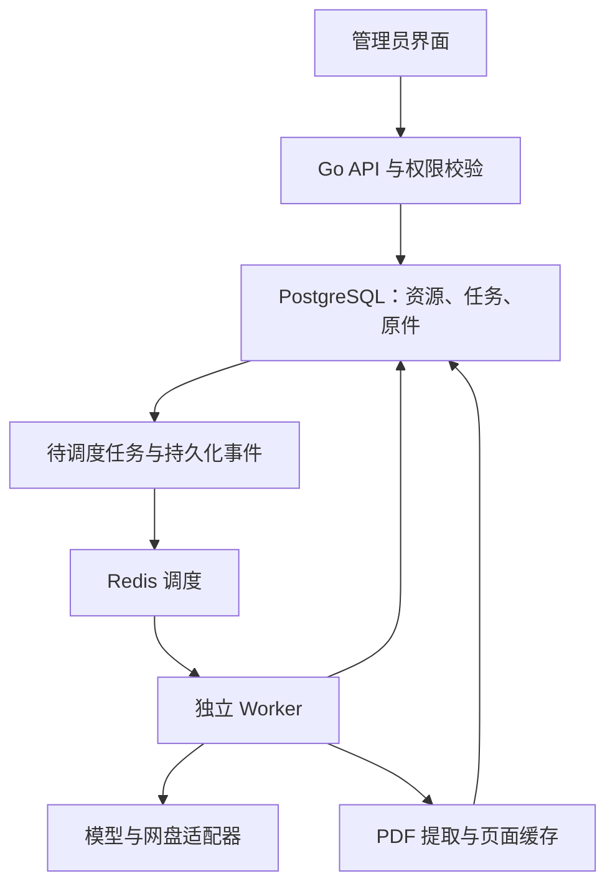

# Learning v2.0：架构与数据迁移设计

状态：P0 设计，尚未实现。代码事实与基线见 [审计报告](P0_AUDIT.md)，阶段门槛见 [实施计划](IMPLEMENTATION_PLAN.md)。本文的字段、默认值与接口是实施契约建议，不是当前 API。

## 1. 架构选择

保留现有 Next.js + Go `net/http` + PostgreSQL + Redis + Compose。前端统一后台布局；后端把认证、AI 调用、任务执行、文件访问和资源业务逐步抽出服务层，新旧路由调用同一实现。避免先重写所有业务或引入新的 ORM、对象存储、搜索集群。

Compose 增加独立 `worker` 进程，可与 API 共用同一构建产物，通过明确的运行模式启动；迁移仅由 API/迁移命令串行执行，Worker 等待 schema 就绪。API 不再自动启动重复 Worker。下载、扫描、OCR 和 AI 解析均排队，HTTP 返回 202 和任务 ID。

PostgreSQL 是资源、任务、审核和原件的唯一持久化真值。Redis 用于调度通知、延迟重试和分布式并发控制；队列丢失后从数据库恢复。初版不引入另一套同时维护状态的任务数据库。

## 2. 资源工作流与并发约束

三个相互独立的字段体系：

| 维度 | 示例值 | 作用 |
| --- | --- | --- |
| `stage` | `A / B / C / library` | 管理员看到的处理区域 |
| `classification_status` | `pending / proposed / needs_confirmation / confirmed` | 分类是否足够可靠 |
| `review_status` | `not_ready / pending / changes_requested / approved` | 结构化内容审核状态 |

任务另有 `queued/running/retry_wait/paused/cancel_requested/cancelled/completed/failed`，不把错误或取消当成新的资源区域。C 区同时容纳正在深度解析、失败待修复、待审核等资源；正式库只读取已批准发布的修订。

| 操作 | 前置条件 | 原子结果 |
| --- | --- | --- |
| 导入 A | 原件校验通过、内容/来源去重 | 原件引用、资源、来源记录一起提交 |
| A→B | 轻量任务成功、证据校验通过 | 保存分类修订和依据；达到阈值进 B；不足留 A 待确认 |
| 人工确认 A→B | 管理员核对实际内容 | 保存人工分类与依据；不要求虚构教材信息 |
| B→C | 已确认分类/策略，管理员批选或满足预设规则 | CAS 更新 stage 并创建深度任务；若入队事务失败则均不改变 |
| C 审核 | 解析版本完成、发布校验通过 | 审核记录绑定同一版本 |
| C→正式库 | 该修订批准且未失效 | 发布指针切换；旧正式修订仍可追溯 |
| 退回/重新分类 | 管理员指定原因 | 生成新修订，旧解析保留；旧任务失效，不覆盖人工修订 |

资源有 `revision`，分类有 `classification_revision`，解析有 `analysis_run_id`，Worker 有租约 generation。所有阶段、标签、审核及发布写入使用预期修订号；冲突返回 409。不得通过移动文件来表达状态。

已发布资源重新解析时建立候选修订，不能让未审核的新结果覆盖正在使用的正式内容。重新分类需标记受影响的解析/题目关联为待复核，不悄悄移动已发布题目。取消只中止任务，不删原件。

## 3. 数据模型：优先复用

### 3.1 现有表的扩展

| 现有表 | 继续承担 | 增量变化 |
| --- | --- | --- |
| `ai_providers` | 平台服务商与加密凭据 | adapter 类型、配置修订、同步/测试状态；密钥不返回前端 |
| `ai_models` | 管理员已选可执行模型 | 引用目录项、配置修订、能力覆盖声明；保留原 ID、kind 和 TTS 字段 |
| `permission_groups` / `group_models` | 身份组授权 | 不再新增平行授权表；授权操作加 revision、服务端批量事务 |
| `learning_ai_tasks` | 任务配置与提示词 | 增加路由模式、预算、超时、失败规则；保留已有 prompt/revision 与作文主审语义 |
| `learning_documents` | 逻辑资源主记录 | stage/type、修订、主学科可空、可选教材/考试属性、分类/审核状态、正式版本指针 |
| `learning_pages` | 原生文本、OCR、页图缓存 | 绑定源文件引用、覆盖范围、提取器版本与质量信息；保留原 question/answer 页 API |
| `learning_questions` | 题干、答案、题组、发布标记 | chapter_id 可空、规则版本、置信度、答案来源、审核修订；沿用 ID 和已有内容 JSON |
| `learning_assets` | 图片和来源裁剪框 | 可关联内容单元/解析版本；不丢失现有题图 |
| `learning_chapters` | 教材章/Unit/小节 | 标准教材引用、父子层级；不把专题伪装成教材章节 |
| `learning_jobs` | 唯一持久化工作台账 | resource/run 引用、作用域、租约、心跳、进度、重试、取消、检查点、调度事件版本 |
| `account_audit` | 非敏感账户/管理审计 | 保存操作者和配置变更摘要，不保存凭据或完整学生对话 |
| `learning_cloud_connections` | 已授权 WebDAV 等连接 | 适配器类型与能力标志，复用加密；分享提取码单独加密保存 |

### 3.2 确有必要的新逻辑实体

名称可在迁移落地时调整，不能另建与上表相同用途的 providers/models/jobs/questions。

| 新实体 | 必要性与关键约束 |
| --- | --- |
| `ai_model_catalog` | 服务商同步目录快照；唯一(provider_id, remote_id)；上下文/模态/价格原值、来源与同步时间，可为空 |
| `ai_task_candidates` | 有序候选或评审成员；外键 task/model，mode/role/priority 明确，避免 JSON 数组里混淆备用和并行评审 |
| `ai_invocations` | 任务/模型/供应商、用量、费用状态、延迟、错误码、重试；不存 API Key、Cookie，文本内容默认不写日志 |
| `learning_blobs` | 原件按 SHA-256 去重的不可变 bytea、大小/MIME、校验信息；同哈希校验大小，不按标题去重 |
| `learning_resource_files` | 资源与原件关联；primary/answer/attachment 角色；一份原 PDF 可被多个逻辑内容单元引用 |
| `learning_resource_sources` | 本地路径快照/上传/分享远端 file_id、来源版本与名称；内容相同也不丢失不同来源 |
| `learning_classifications` | 每次分类的结果、字段依据、模型/规则/抽样预算、人工修订与证据覆盖，追加保存 |
| `learning_terms` + `learning_resource_terms` / `learning_question_terms` | 专题与知识点分别标 kind，按学科命名；多对多关联，人工/AI 来源与置信度可追溯 |
| `learning_resource_chapters` | 同一资源关联多个章/Unit，关系带证据；主分类不依赖此表 |
| `learning_textbooks` | 学科/出版社/版本/册次/目录版本；英语教学目标北师大2019，其余可配置 |
| `learning_analysis_runs` + `learning_content_units` | 深度解析版本、策略、检查点、章节/讲义正文/题组等逻辑单元与页码位置；不要求拆原文件 |
| `learning_reviews` | 对资源/题目及其具体修订作出批准/退回，记录依据与编辑摘要 |
| `learning_exam_rules` | 地区/学科/年份/考试类别/卷型/修订、来源、审核状态；未核实题量分值可空 |
| `learning_question_revisions` | 不可变已发布题目快照，使现有 attempt 的 question_revision 能读到对应内容 |
| `learning_shares` + `learning_share_files` | 加密提取码/连接引用、目录分页快照、远端 ID、大小和版本；不保存可泄露的下载签名到 AI 输入 |
| `learning_share_imports` | 明确批准的文件 ID 集合、目录快照、流量预算、下载任务和逐文件结果 |

主分类为资源的主学科和资源类型；辅助标签、专题、知识点、教材关联独立。跨学科资源可暂时主学科为空并关联多个学科标签，C 区内容单元/题目再分别确定学科。

资源类型覆盖：教材正文、教材同步习题、语法专题、知识点专题、单元检测、综合训练、高考真题候选、模拟卷、阶段测试、复习讲义、其他、混合资源。`textbook_alignment` 为 `yes/no/unknown`，不从“英语”直接推出北师大版。真题另存 `authenticity_status`，分类不等于来源认证。

### 3.3 原件与页缓存

v2 首版继续 PostgreSQL 原件存储，新增 blob 层只解决相同内容重复存储和通用文件关系。原件只追加、不可被 AI 修改；导入、去重和资源记录可在同一数据库事务完成。磁盘临时下载/渲染文件使用服务私有目录，未完成文件不进入 A。

单份 PDF 为默认；答案可不提供，也可作为可选关联文件。同一文件含题目/答案时仅存一次 blob。旧 question_pdf/answer_pdf 保留读取兼容；新资源不得通过写空假 PDF 来满足约束。

页缓存继续服务一份 primary 和可选 answer 的物理页，旧 `kind=question` 对应 primary。多份附件各自作为源资源引用，不挤入同一组 document/kind/page 键。抽样文本必须保存 `coverage=sampled` 与具体范围，不能冒充全文；深度提取可扩充覆盖。历史 OCR/解析结果由 analysis run 保存，页缓存仅是可重建视图。

优点是无需立即改变已有数据库备份覆盖原件的语义。代价是大 PDF/页图仍会增加数据库与备份负担：新入口文件上限建议先维持旧 32MiB，超限明确提示；提高到 64MiB 等值前必须通过内存/备份压测。未来对象存储需另设校验后切换、双读和备份恢复项目，不能在本轮悄悄搬走旧 bytea。

## 4. 模型目录、选择器与路由

### 4.1 管理交互

保存服务商 → 测试鉴权/目录访问 → 同步模型目录 → 选择器自动打开 → 搜索/排序/类别多选 → 设置任务池和身份组 → 事务保存。没有模型接口时展示具体原因并进入手动备用，不让整个服务商配置丢失。

优先通用 `<base>/models`，OpenRouter 使用专用适配器补充其可获取字段。保留既有 HTTPS/DNS/私网拒绝和禁止任意重定向的客户端；模型发现接口必须支持 GET，不复用硬编码 POST 的 `upstream()`。Base URL 规范化只补适配器明确的路径，不反复猜测并向未知地址发送密钥。

目录项与启用模型分开：同步新项不自动授权；同步缺失不删除正在使用的模型，标为 stale 并提示核对；失败不覆盖上次成功快照。目录接口有分页、响应体/条目数、超时和并发限制。

价格保存原始字符串/decimal、币种、计费单位、来源、获取时间；每百万 token 展示须有正确单位换算，输入/输出/图片/请求分别呈现。未知显示“未提供”，不能变为零。目录价格是公开报价，不是实际账单。模型支持视觉/JSON/PDF等能力需区分供应商声明、管理员声明和测试结果；未知能力不能自动当已支持。

复用 `ModelScopeSelector` 的范围总开关与范围外选择保留规则。扩展上下文/价格/名称排序、模态和可用性筛选、全选/清空、批量启停；长列表分页或虚拟化。跨页全选必须显示范围、快照和数量。批量启停与组授权是两种动作，界面明确标注并在服务端原子提交。

连接成功只说明接口/目录鉴权；逐模型测试为管理员明确触发的短请求，显示会产生调用，限制输出，验证需要的模态与结构化参数。目录出现不能证明模型可付费调用或性能达标。

### 4.2 统一授权

学生执行候选 = 任务允许集合 ∩ 用户身份组授权 ∩ 已启用模型/服务商 ∩ 必需能力/预算。用户自选模型也在交集中校验。每次外部调用前重新检查，返回/提交结果前再次检查；排队期间撤权、停用或模型修订发生变化时不得换到未授权模型。

管理员在资源管理域可配置系统处理任务；在学生学习域仍按用户组权限执行，不能因为角色为 admin 而改变学习选择器契约。后台任务保留创建者、执行域和当前权限核验；不依赖 Worker 拥有的进程权限来跳过业务授权。

不设置用户调用次数、对话次数配额。并发槽、队列长度、单请求 token/耗时和系统资源上限属于保护机制，不能变成隐藏的用户每日额度。

现有 personal API 的密文与设置保留，不能让普通用户通过任意字符串模型或隐式失败降级绕开新身份组要求。如继续开放 BYOK，需管理员显式权限及组内模型映射；本轮默认执行入口统一授权，不自动向个人接口发送后台资源。

### 4.3 任务映射与失败策略

| 任务用途 | 复用/新增任务键 | 执行模式 |
| --- | --- | --- |
| 分享目录文件名预筛选 | 新 `share_prefilter` | 元数据限定；有序首选/备用 |
| A→B 轻量识别 | 复用 `classify_document`，新增版本/预算 | 有序候选，低成本优先 |
| B→C 深度解析 | 新 `deep_parse` 编排已有子任务 | 按资料类型决定子任务 |
| OCR/结果理解 | 复用 `ocr`，可增 `ocr_understanding` | 抽样与全文有不同预算上下文 |
| 学科/知识点 | 复用分类并增 `knowledge_classify` | 字段证据、受控词表 |
| 题目/答案结构化 | `extract_questions/answers/match_answers` | 分步；缺答案不阻断其他题目草稿 |
| 英语句子 | 复用 `sentence` | 用户组授权和任务候选 |
| 助学对话 | `tutor/question_tutor/explanation` | 保留用户选择和按需讲解 |
| 作文批改 | `essay_reviewer/essay_lead` | 独立评审集合+主审，另设各角色备用 |

候选顺序由显式 priority 决定，复选框勾选顺序不代表优先级。管理员可配置超时、同模型重试、总尝试次数、备用、是否允许价格上浮和结构化修复。

- 超时/连接错误/429/部分 5xx：指数退避加随机抖动，遵守可用的 Retry-After；在总预算内切备用。
- 401/403/余额不足：标记配置/服务商问题，停止同凭据盲重试；仅在已显式配置其他候选时回退。
- 400/能力不兼容：不原样重试；切满足能力的候选或返回待配置。
- JSON/引用校验失败：最多一次有预算的修复尝试，否则转人工审核；不得牺牲证据校验来“成功”。

OpenRouter 自身供应商回退与 Learning 模型回退分别记录；明确可否用非指定供应商、费用上限和隐私要求，防止双重重试膨胀。实际吞吐/首字延迟只能来自有来源的观测或测试，不能按模型名称保证速度。

## 5. A→B 轻量分析

### 5.1 分层执行和停止规则

1. 校验 MIME/文件魔数、大小和 SHA-256；读取文件名、路径、来源与可信标签。命中相同 hash+规则/人工确认的有效缓存可直接复用。
2. `pdfinfo` 等读取元数据/页数，支持时读取书签/目录标题。不得调用现有全文件 `pdfTexts()` 或 `recognizePDF()` 来实现轻量阶段。
3. 原生文本按物理页范围提取：封面/版权或目录、开头正文，必要时分散抽样中部/尾部。先小样本，再按剩余预算扩展，记录选页原因。
4. 仅对抽中且缺少可用文本的页面 OCR；OCR质量差或预算不足就待确认。
5. 规则可高可靠判定时无需 AI；否则把有限证据交给轻量模型。校验结构、词表、原文依据与页码，保存 proposal，不输出答案解析。

不能盲信文件名。为覆盖“英语练习.pdf 实为数学”，来自普通上传/网盘的文件即使名称很清楚，也做便宜的实际内容核对；仅可信清单/已验证内容哈希缓存可免重复读取。没有矛盾不等于证明全文单一，结果要显示抽样覆盖范围。有限抽样不保证发现未抽中页的少数混合内容。

建议初始参数（P4 压测后确认，不是准确率承诺）：

| 参数 | 建议默认 | 耗尽后的行为 |
| --- | --- | --- |
| 页数 | 先 2 页，最多 6 页 | 未判断清楚则待确认 |
| 单页/总文本 | 2000 / 10000 Unicode 字符 | 优先标题和有代表性的正文；记录截断 |
| OCR 页/图片 | 最多 2 页、2 张输入图；长边至多 1400px | 不升级全文 OCR |
| AI 分类输入/输出 | 输入最多 6000 token；输出最多 1000 token | 保守计数，预留输出与系统提示词 |
| 总运行时间 | 90 秒（含抽样 OCR） | 保存检查点，转待确认/可重试错误 |
| 分类阈值 | 初始 0.85，仅作模型分数阈值 | 不是准确概率；冲突/缺证据强制待确认 |
| 单任务费用 | 由管理员设置，未知报价自动任务不调用 | 明确提示价格未知/超预算 |

页数预算可配置。token 预算包含 OCR 调用输入、图像计费估计和分类请求，不只统计最后一次文本；供应商不能限制/报告某计费维度时标明预算不可精确核验，不能宣称严格总价保证。管理员授权的非自动任务可使用明确的最大输出和费用估计，实际 usage 到达后更新。

缓存键包括内容 hash、抽样策略、规则/提示词版本、分类 schema、必要的模型修订；人工修正优先于 AI 缓存。模型未知字段留 null；证据保存文件 ID、物理页、文本连续引文和可用的 bbox/字符范围、证据类型（文件名/原生文本/OCR/人工）。

### 5.2 输出与 B 区

轻量输出包含主学科、次学科、资源类型、简介、教材同步 yes/no/unknown、可选版本/册次、主题/知识点集合、可选章节、考试候选信息、字段级把握、冲突和依据、抽样覆盖及建议解析策略。不要求所有字段填满。

例：《高中英语语法综合练习.pdf》→ 英语 / 语法专题 / 非教材同步 / 定语从句、非谓语、虚拟语气；版本/册次/Unit 为空。B 区筛选与批量编辑这些维度，展示人工修正覆盖范围。C 区任务启动保存分类修订，后续改标签不能使正在执行的旧策略覆盖新标签。

## 6. B→C 差异化深度解析与审核

| 策略 | 处理产物 | 关键约束 |
| --- | --- | --- |
| 教材 | 真实目录、章/Unit/小节、正文、词汇语法、练习与知识点 | 依据原目录，不硬编码或猜测 Unit |
| 专题练习 | 题组/小题、选项、参考答案、讲解、知识点、难度 | 逐题关联专题；缺答案/低质量部分留草稿 |
| 真题/模拟卷 | 考试元信息、卷结构、板块/题号、材料、图表公式、答案 | 真题候选核对来源；题型规则绑定适用版本 |
| 混合/复习讲义 | 多个逻辑内容单元、讲义结构与不同题组 | 原件完整，单元保留来源/物理页/位置 |

长文按页段/章节/题组分批，逐批持久化检查点与产物 hash；阅读语篇和小题不任意拆开。复用原题干、参考答案提取和配对，但不再强求整批所有题都有答案。区分 `source_reference / human_verified / ai_suggested / missing`，AI 推测永远不能作为原始标准答案。

拆开 draft 校验与 publish 校验：草稿允许答案/章节/题型未知；发布须满足所用内容类型要求。正文/讲义没有答案也可作为阅读资源审核发布；题目要进入自动评分练习则必须有经核验的答案、题型和适用评分规则。未确认的题目可留审核区，不能自动发布或假造答案。

管理员可对照原 PDF 页、OCR 和提取结果，修改学科/类型/知识点/章节/题型/题干/答案/分值；保存是新修订，批准绑定具体修订。批量操作逐项报告成功/冲突/未通过，不能一个失败后静默发布其他未知项。自动发布初始关闭；以后也需来源可信、零待解决冲突、规则与完整性校验通过，不能只凭一个置信度数字。

题目最少保留：学科、资源类型、源文件/页码/位置、题型与规则版本、材料/题干/多小题、选项、可空参考答案和来源状态、解析、知识点多对多、难度（含估计来源）、识别分数、审核状态。图片、表格、公式和图表有独立引用，展示不接受任意可执行 HTML。

## 7. 后台任务可靠性

复用 `learning_jobs`；新增作用域把学生私有评分/讲解和管理员共享资源任务隔离，资源任务的查看/重试/取消要求管理员且执行前复核权限。学生不得靠猜 job_id 获取 PDF、答案或其他人的记录。

1. 创建资源/阶段变更/任务及待调度事件在同一事务提交；`dispatch_version > dispatched_version` 为可重建 outbox。调度器发布 job_id+版本到 Redis 后记录已发送，崩溃导致重复通知由数据库领取去重。
2. Redis 不含大 PDF/密钥。Worker 以数据库 CAS/行锁领取，设 lease_owner、lease_until、generation 和 heartbeat。初值可取 90 秒租约、20 秒心跳，压测后调节。
3. 任务和所有中途产物写入须校验仍持有租约、generation、资源/分类/run 修订；不能只保护最后一行任务结果。过期 Worker 的结果拒绝写入。
4. 页段/checkpoint 独立事务幂等保存。相同资源内容+阶段+策略/规则/配置修订产生相同语义键；管理员共享导入不依赖不同 owner 造成重复。强制重新分析创建新的 run，不复用旧完成任务伪装执行。
5. 自动重试仅限暂时性错误；配置错误转待修复，超过次数终止。记录 attempts、next_run_at、最大次数、错误分类和脱敏摘要。
6. 暂停在安全检查点生效；取消中断支持 context 的 HTTP/子进程，取消后所有写入再检查。供应商已接受的调用可能仍计费，界面显示这一边界；不删除原件或已核验结果。
7. Worker SIGTERM 停止领新任务，尽可能写检查点；租约超时后可恢复。Redis 整库丢失也能扫描持久化任务重建通知。数据库暂不可用时不能假报成功。
8. 当前 Redis 无持久化：计划为应用建立独立卷和 AOF 设置，避免无意把其他用途的缓存当持久化事实；即使启用也保留数据库重建。

按 workload 区分 interactive/resource/download 通知流和并发槽，避免扫描/OCR占满后学生评分排队；这些仍共用一个任务台账与执行框架。限制全局、服务商、任务类型、下载连接的并发，区分内存/CPU/临时磁盘和 AI token/费用预算。日志含阶段、页段、耗时、预算、重试、失败类别；系统状态页显示积压、Worker 心跳、Redis/数据库和失败趋势。

外部 AI 调用采用至少一次执行，无法保证供应商绝不重复计费；有上游幂等能力时携带稳定请求标识。内部资源、解析结果和发布效果必须幂等，不能把“数据库不重复”宣传成“外部调用恰好一次”。

## 8. 网盘分享适配器

适配器契约：`InspectShare / ListFiles(cursor) / ResolveDownload / Download / Cancel`，返回能力标志、目录版本、远端文件 ID、大小/MIME、来源版本；只在能力确实支持时报告断点续传或不经转存下载。

先检查链接类型/域名与提取码，再读取分页目录快照。AI 输入只含脱敏后的 file_id、名称、路径、扩展名、大小和筛选目标；不得包含提取码、Cookie、API Key、签名下载 URL。AI 只能推荐现有 ID，不能生成 URL 或扩大选择。

管理员看到推荐理由、总文件数、可下载数量、已知总字节、未知大小数量和疑似重复项；确认时提交目录快照 ID、明确的 file_id 集合、最大字节和预设规则版本。未知大小不能按 0 估计；自动规则默认拒绝未知大小或超过预算，文件名含糊时返回“待选择”，不下载整目录。

批准后 Worker 逐文件下载到私有临时文件，校验大小、魔数/格式、hash、传输完整性后一次提交 blob/来源/资源 A。源目录变化、链接过期、鉴权过期返回待修复，不悄悄改选其他文件。支持重试、取消、并发、总流量/速率限制；Range 仅在上游支持且版本一致时续传，否则安全重下并记入实际流量。

保留 WebDAV 为已有授权存储适配器；OpenList 可作为可选连接层，不能当成已具备夸克/百度分享支持。P5 必须用合法授权样例验证目录、不下载未选文件、PDF 下载、分页与鉴权过期；需转存时明确显示操作和授权，不自动大量转存。需要登录/验证码时给出用户可操作状态，不绕过限制。

下载地址使用专用受限客户端：允许适配器确认的公开 CDN 重定向，每跳复核主机和解析 IP；跨域不得转发原 Cookie/Authorization。不得为兼容网盘取消全局 AI 客户端的私网/重定向限制。管理员自定义本地扫描目录也只能选已配置挂载根内路径，网页不能任意读取宿主机。

## 9. 广东教材与考试规则

英语教材目标固定北师大版2019；这一约束只用于教材对齐与课程选择，独立语法专题/试卷的版本可以为空。其他科目版本由管理员选择，不能推断广东全省统一出版社。教材目录来自合法电子资料/管理员核验，不能由模型生成一份号称完整官方目录。

考试规则键包含 region、subject、exam_category、paper_family、applicable_year、revision 与 source。区分全国高考笔试、广东选择性考试、英语听说、合格性考试和平台训练。2026 招生规定支持类别、时间、满分等字段，但不能直接作为各板块题数的依据。题量/分值/顺序需当年对应真卷和官方资料逐项核对。

现有六科题型 ID 保留别名映射，新增规则不破坏旧查询。化学/生物的工艺/实验/遗传等训练标签与官方题型板块、知识点分别保存。高考真题候选的真实性需官方来源或人工来源核验，封面与年份相符只足以称内容一致性核对。规则未核实就显示未知，不套到未来年份。

## 10. 管理导航、认证与多端

统一 `/admin` 布局：资源管理（本地、网盘、A、B、C、正式库、教材/知识点、任务），以及服务商、模型、身份组、AI任务路由、用户、系统安全、系统状态。`/admin/learning` 保留重定向/兼容入口；学生学习区不暴露管理操作。切换筛选/标签使用 URL 状态，支持返回、刷新和深链。

常规保存/授权/分类/审核使用现有登录会话、CSRF、Origin 与服务端角色校验，前端不常驻管理员密码。旧请求中的 admin_password 暂兼容接收但普通接口不再依赖，避免老客户端被严格 JSON 解码拒绝。高风险的本人改密、其他管理员改密/MFA重置、提权/降权等单独动作校验当前凭据，必要时加短时有作用域的重新认证，不能用一个全局“刚验证过”放行所有操作。

初始管理员显式 must_change=true；现有用户不按用户名 admin 一刀切。历史初始账号是否未改密需用可验证的初始化/改密审计依据，无法确定时提示管理员处理。单管理员遗忘密码增加服务器交互式恢复命令：指定用户、隐藏输入新密码、事务改 hash/设置必改/撤销会话/审计；不接受公开 HTTP 无凭据重置、不打印/硬编码密码、不通过改 .env 旁路恢复。

手机使用完整页面/抽屉编辑、PDF与结果可切换并保留页码；平板/桌面可并排对照，大屏控制阅读宽度并支持键盘。模型列表、网盘树和任务结果渐进加载，批量动作移动端固定工具条；保留选择、错误与失败项重试。所有核心动作可触控与键盘完成，考虑焦点、减少动效、对比度和长内容，不以玻璃效果牺牲可读性。

## 11. API 兼容契约

新增管理接口放 `/api/v1/admin/`，复用已有角色中间件，降低把管理动作误开放到普通 `/resources` 的风险。学生资源浏览另设只读学习接口，只读已发布版本。建议路径：

| 方法/路径（省略 /api/v1） | 语义 |
| --- | --- |
| `GET /admin/ai/providers/{id}/models` | 读取本地目录快照、筛选/分页、来源与同步时间 |
| `POST /admin/ai/providers/{id}/models/sync` | 后台同步，202+job_id |
| `POST /admin/ai/providers/{id}/test` | 独立连接测试，不暗中批量调用全部模型 |
| `POST /admin/ai/models/{id}/test` | 有限输出的逐模型能力测试 |
| `PUT /admin/ai/model-selections` | 按明确范围保存选择/批量启停，携带配置修订 |
| `PUT /admin/ai/task-routes` | 原子保存有序候选/评审角色和失败策略 |
| `GET /admin/resources` | 按阶段与多维分类查询，游标分页 |
| `POST /admin/resources/uploads` | 原始单文件导入，允许可选答案关联 |
| `POST /admin/resources/scans` | 挂载根内增量扫描，202+job_id |
| `POST /admin/resources/{id}/classify` | 轻量分类，幂等键与资源修订 |
| `PATCH /admin/resources/{id}/tags` | 分类/关联修订，保留人工证据 |
| `POST /admin/resources/{id}/deep-analyze` | B→C，明确策略/版本/预算 |
| `POST /admin/resources/{id}/approve` | 对具体完成修订审核发布 |
| `POST /admin/resources/{id}/return` | 退回并给原因，不删结果 |
| `POST /admin/resources/batch` | 明确 ID/筛选快照范围、修订、逐项结果 |
| `GET /admin/resources/jobs/{id}` | 管理域进度、检查点和安全错误 |
| `POST /admin/resources/jobs/{id}/{action}` | action 限 pause/resume/cancel/retry；CAS 校验 |
| `POST /admin/resources/shares/inspect` | 链接校验与目录读取任务 |
| `GET /admin/resources/shares/{id}/files` | 脱敏分页目录与快照 |
| `POST /admin/resources/shares/{id}/analyze` | 仅目录元数据推荐 |
| `POST /admin/resources/shares/{id}/imports` | 明确批准的文件集合与总流量预算 |

保留 `/admin/providers/models/groups`、`/admin/learning/*` 和 `/learning/jobs/*`，通过适配层复用新服务。幂等键必须绑定操作者/管理域、输入指纹和目标修订；同 key 不同输入返回冲突。新增错误结构可扩展 code/retryable/details，但保留原 error 字符串。409 表示修订冲突，422 表示内容不能发布，202 不代表分析完成。

## 12. 迁移与回退

只新增 0008 之后的迁移，不修改已执行的 0001–0007。先扩展、后回填、再切写入/读取；完成门槛以前不删旧列，不转换原件路径，不更改生产账号或 APP_ENCRYPTION_KEY。

1. **基线与保护**：在隔离副本演练；核对记录数量、原 PDF hash、现有权限/密文、章节/题目/作答引用。迁移函数加全局 advisory lock 和 schema 版本检查，防多 API 同时执行。
2. **P1/P2**：模型目录/候选/调用记录和配置版本；已有 ai_models ID、组授权、提示词与顺序保留。非作文原先只有第一项生效，后续项先显示“未启用备用”，不自动改变付费调用。修复新建初始管理员，既有账户只按证据处理。
3. **P3**：资源 stage、分类/审核状态、任务租约/事件、blob/file/source 表。旧资料用确定 ID 映射，原 bytea 保留；批量回填 hash 并校验后建立引用，不在启动事务内拷贝整库大文件。新资源启用前放开旧 PDF NOT NULL，双读兼容。
4. **历史阶段映射**：未确认/无有效识别 → A；已有有效分类且未开始深度产物 → B；有目录/深度任务/草稿 → C；已有发布题目的资料保留正式题目并映射到正式可读版本，有未完成部分则另保留候选 C 修订。无法可靠映射标 legacy_needs_review，不能从 scope_confirmed=true 推定全部已审核。
5. **P4/P6**：旧 recognition/outline/pages/provenance 原样保留并标 legacy；不把 high 换成校准概率、不伪造缺失资源类型/教材关系。新解析写独立 run，旧路由投影兼容；旧任务状态不强制重置，迁移窗口先停止领任务并等待/回收旧租约。
6. **P7**：知识点/教材关联、规则和题目修订；放开 chapter_id 同时改 INNER JOIN 为允许空关联的查询，测试无章节题进入学习区。首次保存当前题目版本快照；更早已丢失的历史内容不能由迁移补造。
7. **切换**：功能开关按阶段启用，在同一资源上只允许一个写入实现。先影子比对/只读预览，再开放新写入。升级保留 .env、Compose 项目名、数据库卷、只读资料目录与端口。
8. **回退**：关闭新增入口/自动调度，暂停 Worker，保留原件和所有新表。兼容旧读取不等于任意旧二进制可直接写新数据；当已有无章节题/单文件资源后，只回退到已实现双读的兼容版本。不得靠 DROP TABLE、清卷或删资料完成回退。

每阶段检查迁移重复执行、从 0007 旧库升级、外键/唯一性、密文未改变、原件 hash、旧发布题与学习历史可读。所有备份、真实生产迁移和部署均由后续明确的部署任务处理，本 P0 未执行。
